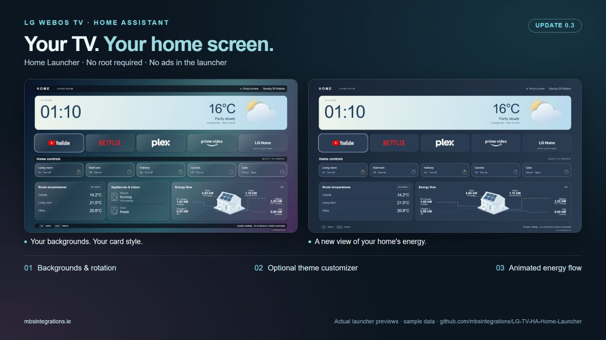
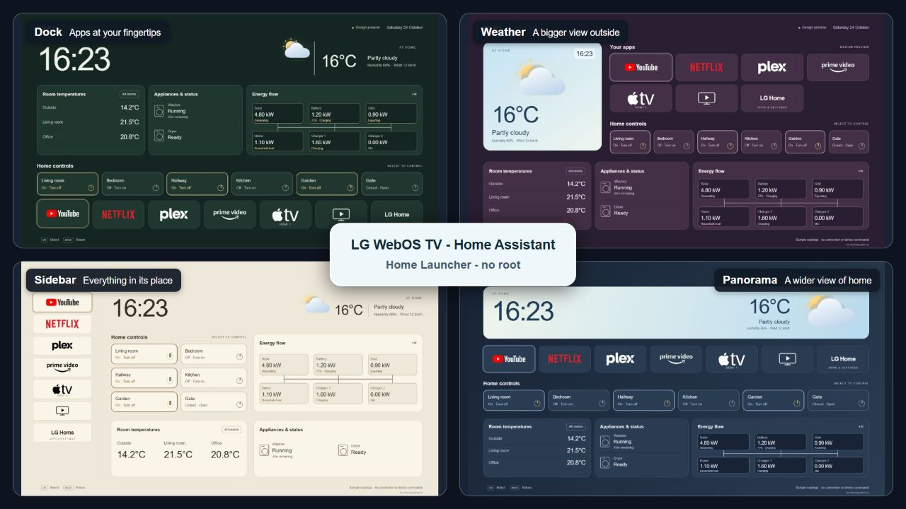
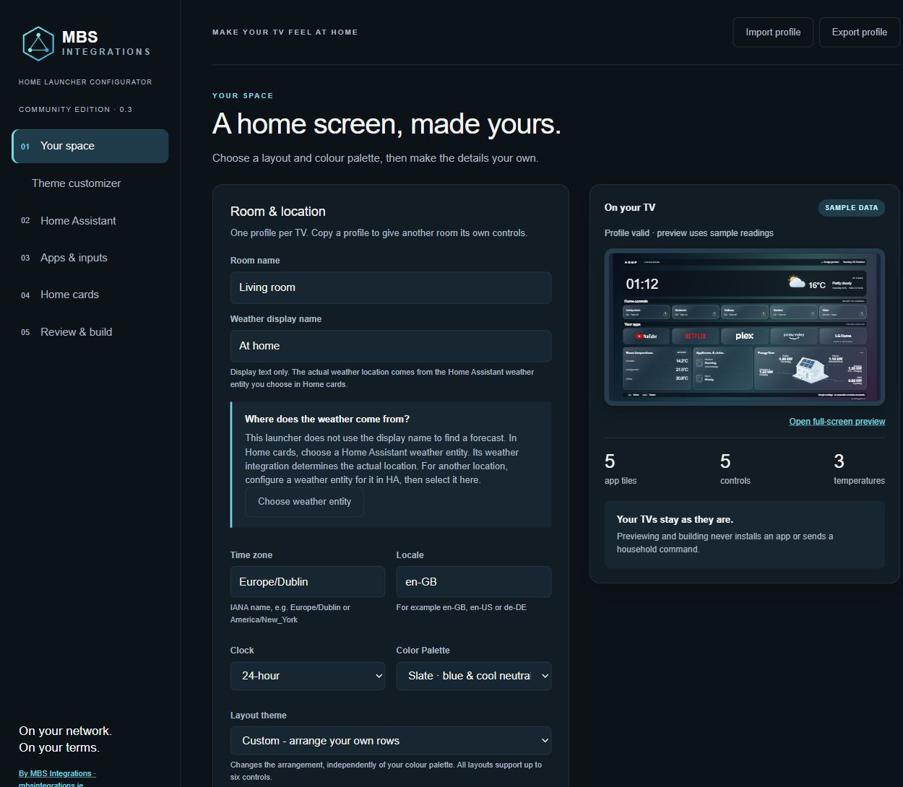
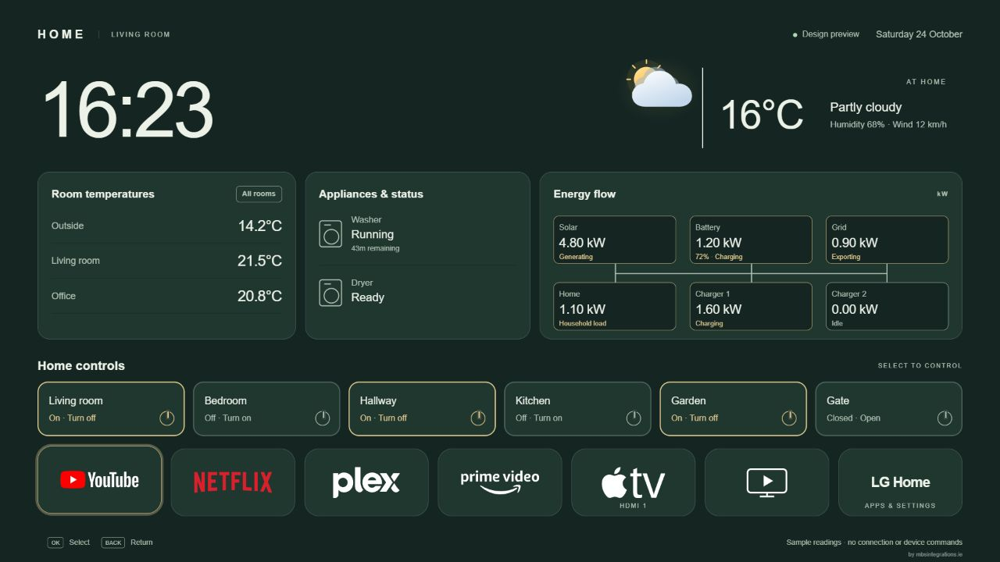
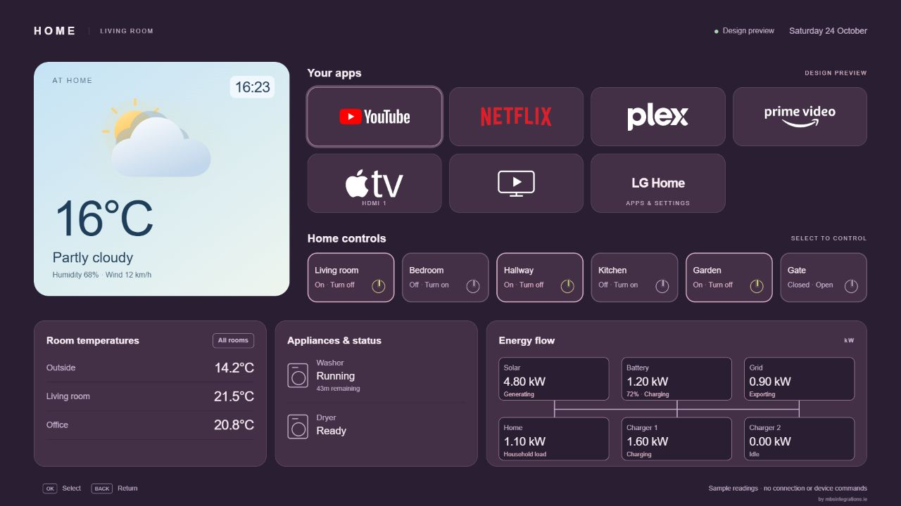
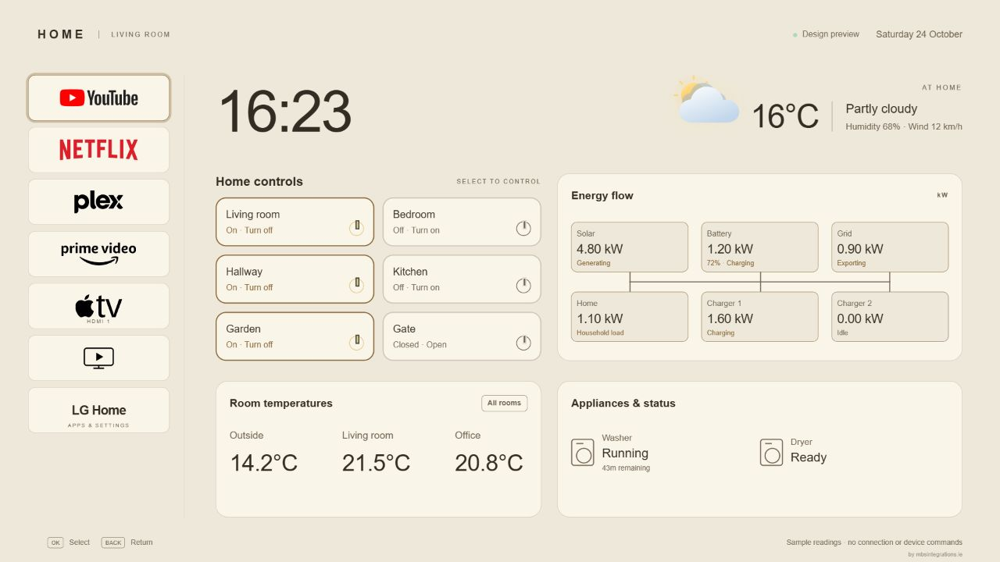
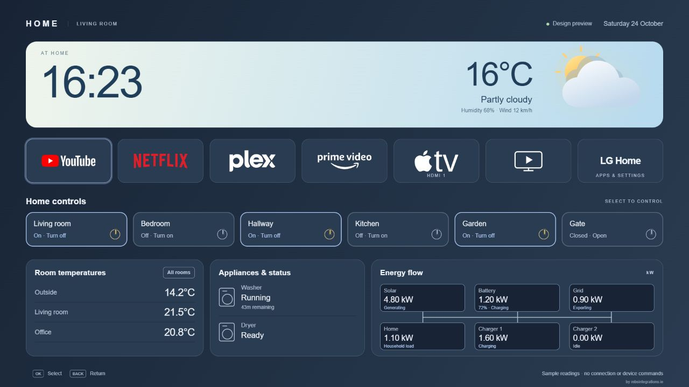

# LG TV – HA Home Launcher

[](https://github.com/mbsintegrations/LG-TV-HA-Home-Launcher/actions/workflows/ci.yml)
[](https://github.com/mbsintegrations/LG-TV-HA-Home-Launcher/releases)
[](LICENSE)
[](https://github.com/mbsintegrations/LG-TV-HA-Home-Launcher)

[](https://paypal.me/mwahl1973)
[](https://mbsintegrations.ie)

> **Ad-free home screen:** our launcher displays no ads or the promotions you would normally see on LG Home. It does not change LG's underlying privacy or data-collection settings. Read **[LG privacy concerns, what this launcher does, and securing your media/IoT network](docs/PRIVACY-AND-NETWORK.md)**.

**Public release v0.4.0.** See [compatibility and validation](docs/VALIDATION.md).

A configurable home screen for LG TVs: streaming apps, HDMI sources, weather, room temperatures, lights, energy flow and configurable appliance/device status. Designed for the remote, with a compact 1920×1080 layout that scales to the screen.

The launcher talks directly to your Home Assistant. The setup computer can be shut down afterwards. No cloud account with this project, Mac service, Docker relay, or custom HA integration is required.

**[Start here](docs/START-HERE.md)** · [Screenshots](docs/SCREENSHOTS.md) · [Configuration](docs/CONFIGURATION.md) · [Manual Home-button helper](docs/HOME-BUTTON-HELPER.md) · [Troubleshooting](docs/TROUBLESHOOTING.md) · [TODO / roadmap](TODO.md) · [All documentation](docs/INDEX.md)



*Make it yours: backgrounds, card styling, custom arrangement and animated energy flow. Actual app previews with sample data.*



*Four new layout themes: Dock, Weather, Sidebar and Panorama. Actual app previews with sample data.*

## Install in order

1. [Download the release source](https://github.com/mbsintegrations/LG-TV-HA-Home-Launcher/releases), verify its checksum and [start the local configurator](docs/START-HERE.md).
2. Choose a layout, connect HA and build your own private IPK. The public sample IPK has no HA token.
3. [Enable TV Developer Mode](docs/DEVELOPER-MODE.md), then [pair and install with webOS Dev Manager](docs/WEBOS-DEV-MANAGER.md).
4. Check the base app on your TV before adding [startup automation](docs/HOME-ASSISTANT.md#start-home-when-the-tv-turns-on) or the [optional manual Home-button helper](docs/HOME-BUTTON-HELPER.md).
5. [Keep Developer Mode active](docs/DEVELOPER-MODE.md#automatic-renewal-with-home-assistant): set up the supplied HA renewal package, reuse existing Camera Overlay renewal, or extend the session manually before expiry.

The computer is only needed for setup and updates. The installed TV app connects directly to your existing HA instance. The helper is an advanced, model-dependent option; the base app can be used without it.

## What you get

- Four new layout themes — Dock, Weather, Sidebar and Panorama — plus Classic, with six independent colour palettes and custom colours.
- [Personal backgrounds and an optional theme customizer](docs/CUSTOMIZER.md): up to five optimized images, rotation, opacity/darkening, four card finishes including Glass, corners and per-card colours.
- Drag-and-drop app/control ordering and a Custom arrangement for the four screen rows.
- Animated house energy flow alongside the classic diagram and simple readings; optional battery and charger branches.
- [Embedded Cloudflare Speed Test and optional router/internet TCP latency](docs/NETWORK.md), measured on the TV with no separate server.
- Condition-based weather artwork with optional HA Sun day/night selection.
- A local browser wizard for Windows, macOS and Linux, with a working sample preview.
- Read-only HA entity discovery and selection; no YAML editing for the launcher.
- Up to 8 app/input tiles, 6 controls, 12 temperatures (first 3 on the main card), 4 generic appliance/status rows and an optional energy card.
- [Common app presets, optional logos, Live TV and TV Guide tiles](docs/APP-TILES.md). Mix text and logos; keep your existing exported layout.
- Export/import of credential-free layout profiles. One profile per TV.
- A private configured IPK built on your own computer. No source edits required.
- An optional HA startup automation blueprint.
- Optional Home-button helper source, build scripts and extensive manual adaptation/recovery instructions. It is never automatically installed or enabled by the wizard.



*The MBS configurator has its own branding. The TV app has no MBS logo or branded colour scheme.*

## Screenshots

See **[backgrounds, card styles and animated energy flow](docs/SCREENSHOTS.md#new-in-030)**, or explore **[all layout and colour combinations](docs/SCREENSHOTS.md)**: 24 combinations for the four new themes, six for Classic, and one custom-colour example per layout. App tiles stay the same throughout the gallery.

| Dock · Forest | Weather · Dusk |
| --- | --- |
| [](docs/SCREENSHOTS.md#dock) | [](docs/SCREENSHOTS.md#weather) |

| Sidebar · Sand | Panorama · Slate |
| --- | --- |
| [](docs/SCREENSHOTS.md#sidebar) | [](docs/SCREENSHOTS.md#panorama) |

For setup screens, see the **[six-step configurator walkthrough](docs/CONFIGURATOR-TOUR.md)**. [Themes and colours](docs/THEMES.md) explains how to choose and apply a design.

## Quick local preview

Install Node.js 22 or newer. Extract this project outside shared/cloud-synced folders, then run from its folder:

```sh
npm ci --ignore-scripts
npm start
```

On Windows PowerShell use `npm.cmd` in place of `npm`. Open **http://127.0.0.1:8780/**. No TV or HA connection is needed to explore the design. Preview buttons never send device commands. Stop the wizard with Ctrl+C.

## Important boundaries

This is a sideloaded webOS app, not an LG Content Store release. Developer Mode is required. The base app does not replace LG's Home button; use the separately documented helper if your model supports it. The helper is a native program plus JavaScript controller/service, not a universal shell script.

Configuration changes are made in the wizard and applied by rebuilding/reinstalling the package. There is no on-TV settings editor or QR pairing flow. Import your saved profile to update it. This deliberately avoids relying on `localStorage` surviving packaged-app updates.

**Your private configured IPK contains your HA access token. Do not share it.** Public sample packages contain no credential and show “Setup required” on a TV. The browser preview uses fictional sample readings even after HA discovery.

The community app IDs are `com.mbs.communityhome` and `com.mbs.communityhomehelper`.

## Next release

The **0.5 stability candidate** improves helper startup/standby recovery and adds a 10-second delay before optional latency checks. See [candidate notes](docs/RELEASE-NOTES.md), the [TODO / roadmap](TODO.md) and [per-feature TV testing](docs/TV-TESTING.md). The latest public release remains linked above until the candidate is published.

## Compatibility and evidence

**The current launcher is expected to work on webOS 4.x and newer (2018 TVs onward). The base launcher, live Home Assistant data and Home-button helper are also community-confirmed on OLED55B7V-Z with reported webOS/SDK 3.9.0.** Other webOS 3.x models remain unverified and may need compatibility changes. Compatibility is model- and firmware-specific.

| Verified model | Platform / recorded version | Verification |
|---|---|---|
| **OLED65B9PLA** — Living Room, 2019 | webOS 4.x; reported SDK **4.10.0** | Tested on our TV: live HA, app launching, Live TV, HA Guide and Home-button return from YouTube |
| **65NANO766QA** — Master Bedroom, 2022 | webOS 22 generation; reported SDK **7.6.0** | Tested on our TV: live HA, room controls, appliance card and Home-button return from YouTube |
| **43UN73906LE** — 2020 | LG specifies webOS **5.0**; installed firmware/SDK not reported | User-reported: all features working, including the Home-button helper |
| **OLED65CX6LA** | Reported webOS/SDK **5.6.2**; firmware **04.64.00**; SoC **o20** | Community-confirmed: base app, live Home Assistant data and Home-button helper |
| **OLED55B7V-Z** | Reported webOS/SDK **3.9.0**; firmware **06.10.65**; SoC **m16p** | Community-confirmed: base app, live Home Assistant data and Home-button helper |

LG introduced the **webOS 4.x generation in 2018**. The compatibility estimate is based on its Chromium 53 app engine, which our TV code targets. webOS 1.x–2.x use older WebKit engines and are not currently supported or tested. See [LG's web-engine table](https://webostv.developer.lge.com/develop/specifications/web-api-and-web-engine) and [compatibility and validation](docs/VALIDATION.md) for model sources and feature-specific results. The helper remains model/firmware-dependent; the latest background rotation and Glass options have not yet had physical TV performance acceptance.

Own code is GPL-3.0-only. The adapted helper retains its MIT notices. See [NOTICE](NOTICE) and [licensing](docs/LICENSING.md). Independent project; not affiliated with LG or Home Assistant.
