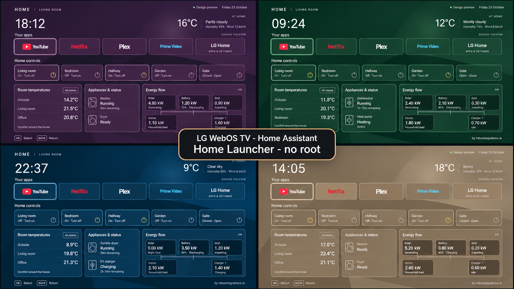

# LG TV – HA Home Launcher

[](https://github.com/mbsintegrations/LG-TV-HA-Home-Launcher/actions/workflows/ci.yml)
[](https://github.com/mbsintegrations/LG-TV-HA-Home-Launcher/releases)
[](LICENSE)
[](https://github.com/mbsintegrations/LG-TV-HA-Home-Launcher)

[](https://paypal.me/mwahl1973)
[](https://mbsintegrations.ie)

> **Ad-free home screen:** our launcher displays no ads or the promotions you would normally see on LG Home. It does not change LG's underlying privacy or data-collection settings. Read **[LG privacy concerns, what this launcher does, and securing your media/IoT network](docs/PRIVACY-AND-NETWORK.md)**.

**Public release v0.2.0.** See [compatibility and validation](docs/VALIDATION.md).

A configurable home screen for LG TVs: streaming apps, HDMI sources, weather, room temperatures, lights, energy flow and configurable appliance/device status. Designed for the remote, with a compact 1920×1080 layout that scales to the screen.

The launcher talks directly to your Home Assistant. The setup computer can be shut down afterwards. No cloud account with this project, Mac service, Docker relay, or custom HA integration is required.

**[Start here](docs/START-HERE.md)** · [Screenshots](docs/SCREENSHOTS.md) · [Configuration](docs/CONFIGURATION.md) · [Manual Home-button helper](docs/HOME-BUTTON-HELPER.md) · [Troubleshooting](docs/TROUBLESHOOTING.md) · [All documentation](docs/INDEX.md)



*Plum, Forest, Ocean and Sand designs with sample data.*


*Four new layout themes: Dock, Weather, Sidebar and Panorama. Actual app previews with sample data.*

## Install in order

1. [Download the release source](https://github.com/mbsintegrations/LG-TV-HA-Home-Launcher/releases), verify its checksum and [start the local configurator](docs/START-HERE.md).
2. Choose a layout, connect HA and build your own private IPK. The public sample IPK has no HA token.
3. [Enable TV Developer Mode](docs/DEVELOPER-MODE.md), then [pair and install with webOS Dev Manager](docs/WEBOS-DEV-MANAGER.md).
4. Check the base app on your TV before adding [startup automation](docs/HOME-ASSISTANT.md#start-home-when-the-tv-turns-on) or the [optional manual Home-button helper](docs/HOME-BUTTON-HELPER.md).
5. [Keep Developer Mode active](docs/DEVELOPER-MODE.md#automatic-renewal-with-home-assistant): set up the supplied HA renewal package, reuse existing Camera Overlay renewal, or extend the session manually before expiry.

The computer is only needed for setup and updates. The installed TV app connects directly to your existing HA instance. The helper is an advanced, model-dependent option; the base app can be used without it.

## What you get

- Four new layout themes — Dock, Weather, Sidebar and Panorama — plus Classic, with six independent colour palettes and custom colours.
- Condition-based weather artwork with optional HA Sun day/night selection.
- A local browser wizard for Windows, macOS and Linux, with a working sample preview.
- Read-only HA entity discovery and selection; no YAML editing for the launcher.
- Up to 8 app/input tiles, 6 controls, 12 temperatures (first 3 on the main card), 4 generic appliance/status rows and an optional energy card.
- [Common app presets, optional logos, Live TV and TV Guide tiles](docs/APP-TILES.md). Mix text and logos; keep your existing exported layout.
- Export/import of credential-free layout profiles. One profile per TV.
- A private configured IPK built on your own computer. No source edits required.
- An optional HA startup automation blueprint.
- Optional Home-button helper source, build scripts and extensive manual adaptation/recovery instructions. It is never automatically installed or enabled by the wizard.


*The MBS configurator has its own branding. The TV app has no MBS logo or branded colour scheme.*

## Screenshots

Explore **[all layout and colour combinations](docs/SCREENSHOTS.md)**: 24 combinations for the four new themes, six for Classic, and one custom-colour example per layout. App tiles stay the same throughout the gallery.

| Dock · Forest | Weather · Dusk |
| --- | --- |
| [](docs/SCREENSHOTS.md#dock) | [](docs/SCREENSHOTS.md#weather) |

| Sidebar · Sand | Panorama · Slate |
| --- | --- |
| [](docs/SCREENSHOTS.md#sidebar) | [](docs/SCREENSHOTS.md#panorama) |

For setup screens, see the **[five-step configurator walkthrough](docs/CONFIGURATOR-TOUR.md)**. [Themes and colours](docs/THEMES.md) explains how to choose and apply a design.

## Quick local preview

Install Node.js 22 or newer. Extract this project outside shared/cloud-synced folders, then run from its folder:

```sh
npm ci --ignore-scripts
npm start
```

On Windows PowerShell use `npm.cmd` in place of `npm`. Open **http://127.0.0.1:8780/**. No TV or HA connection is needed to explore the design. Preview buttons never send device commands. Stop the wizard with Ctrl+C.

## Important boundaries

This is a sideloaded webOS app, not an LG Content Store release. Developer Mode is required. The base app does not replace LG's Home button; use the separately documented helper if your model supports it. The helper is a native program plus JavaScript controller/service, not a universal shell script.

Configuration changes are made in the wizard and applied by rebuilding/reinstalling the package. There is no on-TV settings editor or QR pairing flow. Import your saved profile to update it. This deliberately avoids relying on `localStorage` surviving packaged-app updates.

**Your private configured IPK contains your HA access token. Do not share it.** Public sample packages contain no credential and show “Setup required” on a TV. The browser preview uses fictional sample readings even after HA discovery.

The community app IDs are `com.mbs.communityhome` and `com.mbs.communityhomehelper`.

## Compatibility and evidence

The configurable launcher is installed on an LG OLED65B9PLA (SDK 4.10.0) and 65NANO766QA (SDK 7.6.0). Both TVs have confirmed live Home Assistant data and Home-button return from YouTube. See [compatibility and validation](docs/VALIDATION.md) for the tested features.

Own code is GPL-3.0-only. The adapted helper retains its MIT notices. See [NOTICE](NOTICE) and [licensing](docs/LICENSING.md). Independent project; not affiliated with LG or Home Assistant.
