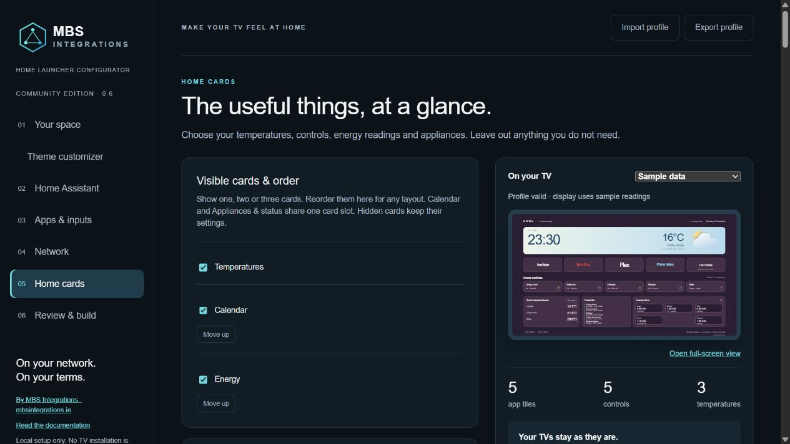

# Calendar, card placement and live preview

## Choose your cards

Open **Home cards → Visible cards & order**. Tick the cards you want and use **Move up** to change their order. You can show Temperature, Calendar and Energy together, any two, or just one. Hidden cards keep their entity mappings and titles. A temperature card needs at least one temperature sensor; Energy also needs its existing enabled setting.

Calendar uses the Appliances & status slot. Switch **Show calendar instead of appliances & status** off to restore the appliance/status card; its settings are retained. Calendar and appliance status cannot occupy two separate slots simultaneously in this version.

For row-based themes, order is left to right and selected cards share the available width. Sidebar has three fixed positions: lower left, lower right and upper right beside the controls. With two cards they share the bottom row; one fills that row. Your imported profile keeps its existing geometry until you edit card visibility or order. The theme customizer's card styling and order still apply.

## Connect a calendar

1. Set up your calendar in Home Assistant first: Google Calendar, local calendar, CalDAV or another supported integration. Confirm events appear in HA's calendar dashboard.
2. Connect the configurator to HA, then open **Home cards** and enable the calendar card.
3. Select one to four `calendar.*` entities. Give each a short label and colour.
4. Choose a title, **3, 4 or 5 events**, and **Today / next 3 / 7 / 14 days**. Today means the current calendar day in the launcher's configured time zone, not the next 24 hours.
5. Review and rebuild your private TV package as usual. No separate Google login is needed in the launcher.

Events merge into one ordered list. Ongoing events are retained until their end; all-day end dates are exclusive. Times use the profile's time zone and 12/24-hour preference. Long titles are shortened visually to fit. Three events is the roomiest option; five is denser. Descriptions, locations and attendee lists are not displayed.

The TV uses Home Assistant's read-only [`calendar.get_events`](https://www.home-assistant.io/integrations/calendar/#action-calendarget_events) action over its existing authenticated WebSocket, with a response. Use an HA version/integration supporting this action and a launcher account allowed to read those calendars. It does not create, edit or delete events. Refresh is every five minutes while Home is visible, and on reconnection; polling stops while hidden. Calendar failures show unavailable rather than pretending there are no events. The other home cards continue working.

## Optional live preview

Above the configurator preview, select **Live HA data · read-only** after connecting HA. It reads the selected entity values every 30 seconds; calendar events use HA's [calendar REST endpoint](https://developers.home-assistant.io/docs/api/rest/). Sample data remains the default. The standalone full-screen preview remains a sample display.

The setup server keeps the token in memory and returns only selected display values and event titles/times/labels to the embedded preview. Device-control and app buttons remain demonstrations: the preview cannot send household commands or install anything on a TV. Requests stop when the configurator tab is hidden. Disconnect or close the setup server to forget credentials. Avoid sharing screenshots containing private calendar titles.

The HA address and explicit plain-HTTP choice survive changing steps, building and reloading the page while the same setup process is running. Tokens are never refilled into the browser. Restarting the server clears the connection; reconnect using your token. Exported profiles contain neither the token nor connection address.

## Screenshots




## Optional image card (still snapshot)

The Energy slot can instead show the latest still picture of a Home Assistant `image.*` entity (or a `camera.*` entity's current snapshot), for example the last motion snapshot an HA automation saved. It follows the same slot-substitution idea as the calendar: when an image entity is set, the image card replaces the energy card; clear it to get the energy card back. It is off by default and existing profiles are unchanged.

In **Home cards → Image card**, choose the entity and a title (up to 28 characters). Keep **Energy** ticked in **Visible cards & order**: the image uses that card's visibility and position, and the energy mappings are not subscribed while it is active. In a profile:

```json
"image": { "entity": "image.front_door_snapshot", "title": "Front door" }
```

How it behaves on the TV:

- The picture is the entity's `entity_picture`, loaded over HTTP(S) from the Home Assistant address the TV already uses. It is reloaded only when the entity's state or that attribute changes (for an `image.*` entity the state is the time of the last update). It is one still image: no video, no polling and no streaming, so it avoids the cost of a live camera feed.
- The state timestamp is shown under the picture as a time, with a short date when it is not from today. Without a usable picture the card says "No image".
- Only when the card is active does the built content security policy gain an `img-src` entry for the Home Assistant origin. The picture is cropped to fill a 4:3 frame.
- `camera.*` entities are accepted but untested on a TV: the card only reloads when the entity's state or `entity_picture` URL changes, so an idle camera can show an old frame. `image.*` entities are the intended use.

In the configurator, sample data shows a placeholder picture. In the read-only Live HA preview the browser never receives the HA token: the setup server serves only the configured image entity through `GET /api/live-image`, requires the setup session, checks the response is an image of at most 8 MB, and the page reads nothing else from it.

