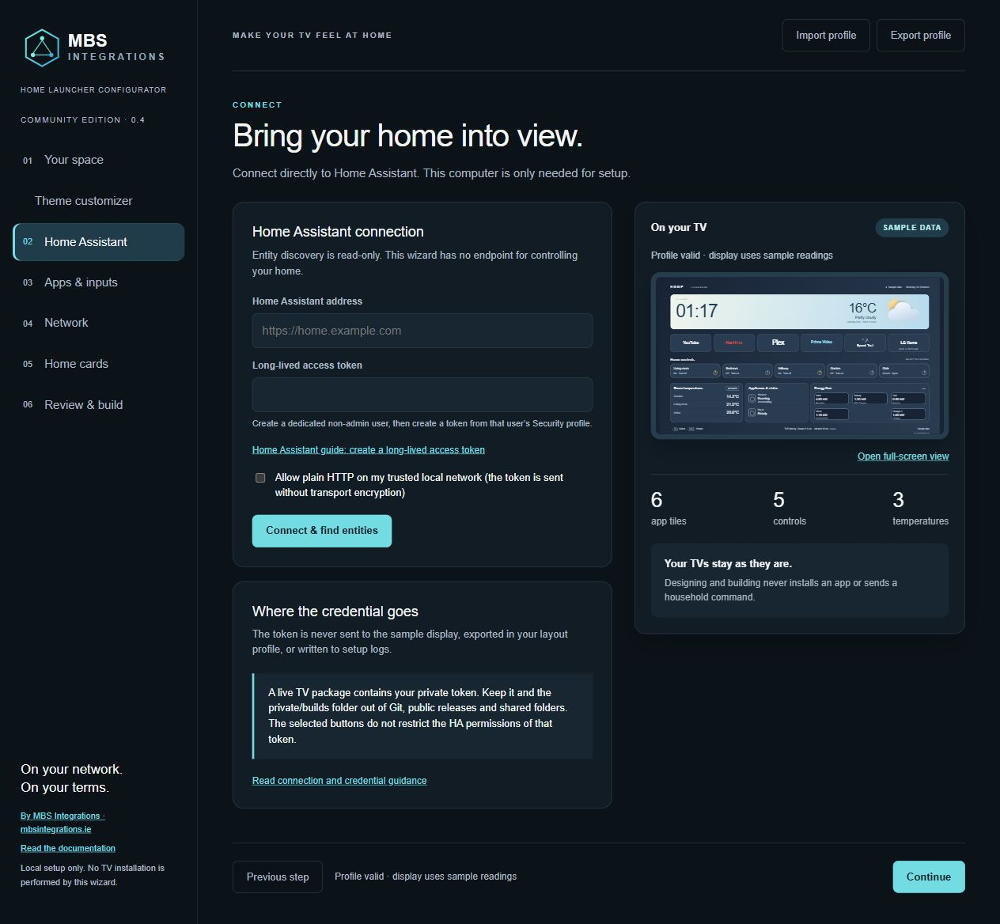
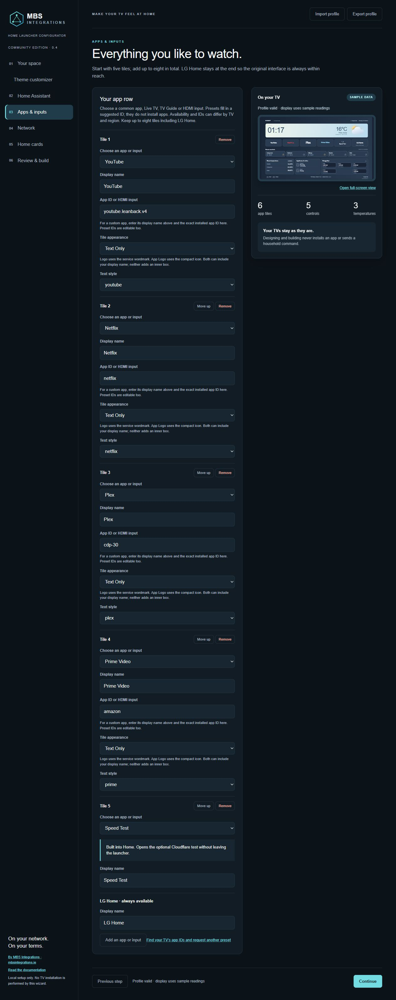
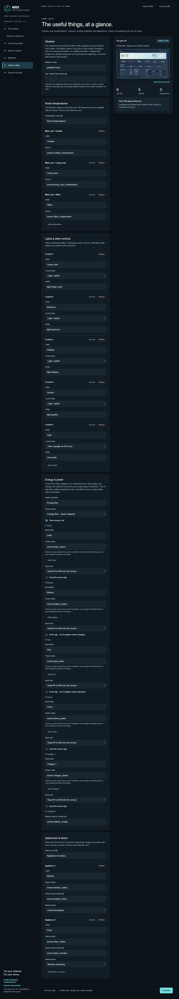
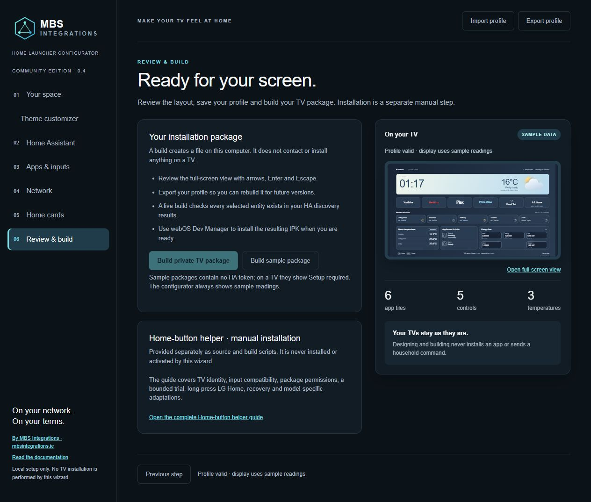
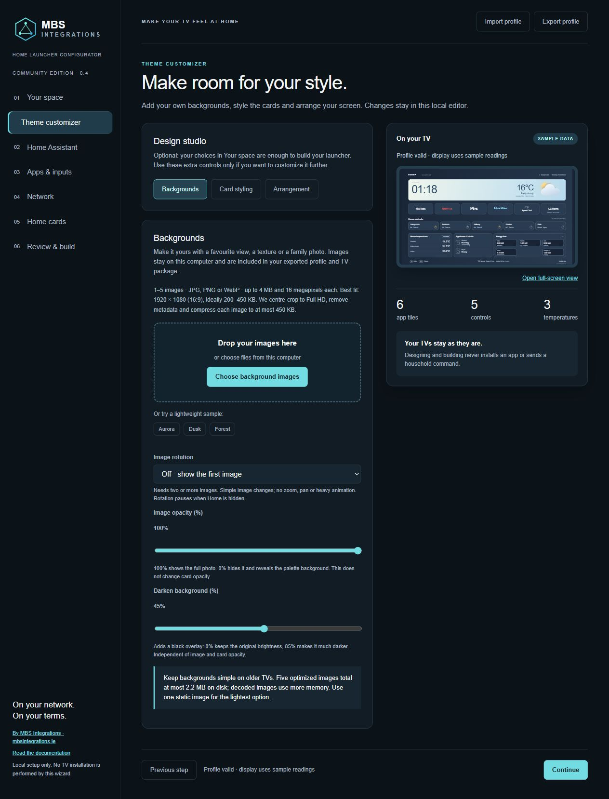
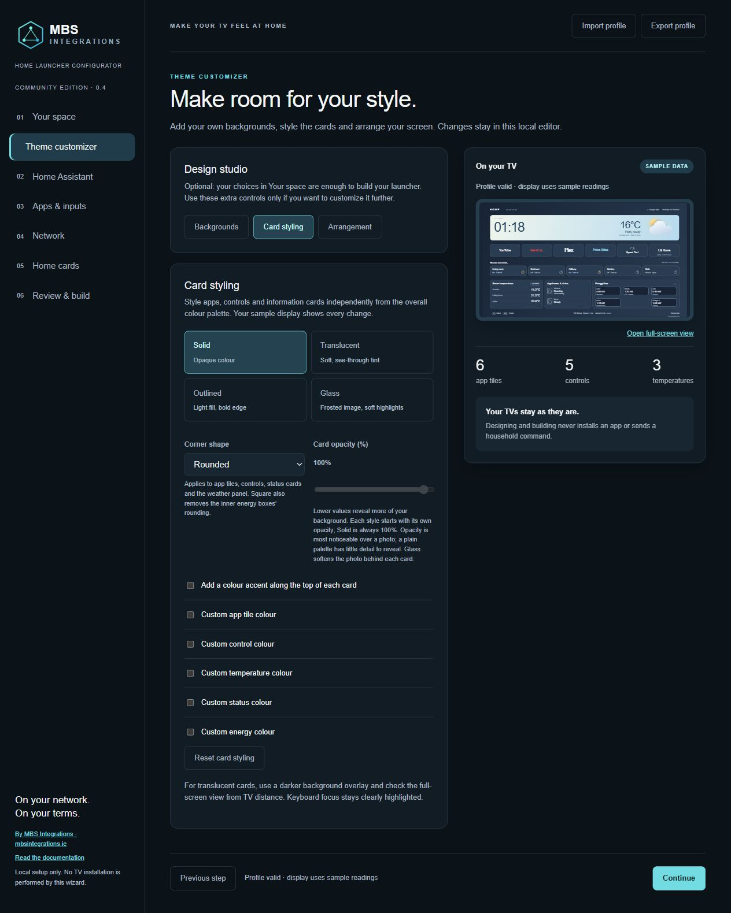
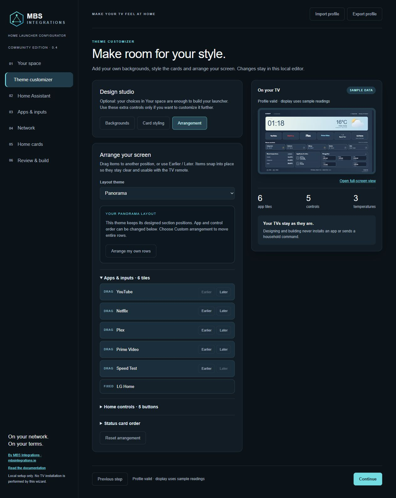

# Configurator walkthrough

The setup wizard runs locally on your computer. These screenshots use the supplied sample profile and empty connection fields; the TV preview always shows fictional readings. Open an image to see the complete step.

Start with [installation](START-HERE.md), then follow these six steps.

## 1. Your space

Name the room and weather label, choose locale/time zone and clock format, then select **Color Palette** and **Layout theme** independently. Custom opens five colour inputs. Weather display name does not change the forecast location. See [themes and colours](THEMES.md).

## 2. Home Assistant

Enter the address reachable from the TV and a dedicated user’s long-lived access token. The linked HA guide explains token creation. **Connect & find entities** discovers states without executing controls. The token remains outside exported profiles and previews; a live IPK contains it and must stay private. See [HA connection](HOME-ASSISTANT.md).

## 3. Apps & inputs

Choose a common streaming app, Live TV, TV Guide, an HDMI input or **Custom app**. Edit the name and exact installed app ID if required, select one of the five appearance modes, and reorder tiles with Move up. Add up to eight tiles including the final LG Home tile. See [app tiles](APP-TILES.md).

## 4. Network

Optionally add Speed Test to the app row and enable router and/or internet latency in the footer. Choose TCP connection latency (recommended), the internet endpoint and the interval. The configurator shows sample readings; real measurements run on the TV. [Network setup, privacy and troubleshooting](NETWORK.md).

## 5. Home cards

Select the weather and optional Sun entities. Put the three temperatures you want on the TV first. Add up to six controls, configure or disable energy, and choose up to four read-only device/appliance status entries. Rename card and node titles to fit your home. You do not need solar, a washer or a dryer. See [full configuration](CONFIGURATION.md).

## 6. Review & build

Check the full-screen preview and export your profile. A private build requires successful HA discovery and checks your selected entities. Build a sample to explore packaging without a token; on the TV a sample asks for setup. Installation and the optional Home helper are separate manual steps. See [webOS Dev Manager](WEBOS-DEV-MANAGER.md) and [helper installation](HOME-BUTTON-HELPER.md).

Export before closing or restarting the wizard; its editing session is held in memory. To update a TV later, import the profile, rebuild and reinstall. See [updates and recovery](UPDATES-AND-RECOVERY.md).

## Optional theme customizer (0.3.0)

Your space now includes background upload immediately below Layout theme. The optional Theme customizer offers Backgrounds, Card styling and Arrangement; the normal Continue button still advances directly to Home Assistant.

Choose the new animated house view in **Home cards → Energy & power → Power layout**. Empty power mappings hide their devices. [Full customizer and energy guide](CUSTOMIZER.md)
