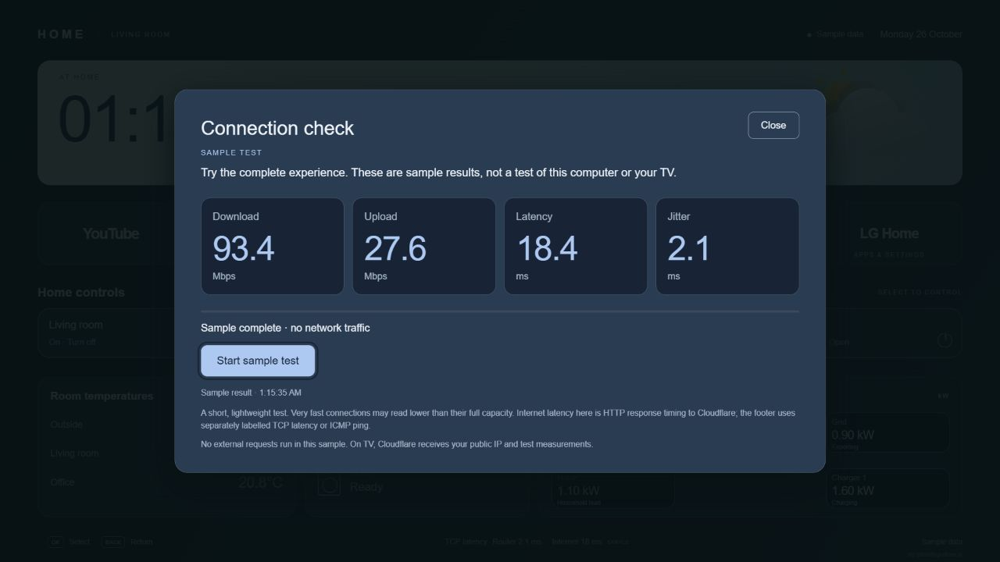
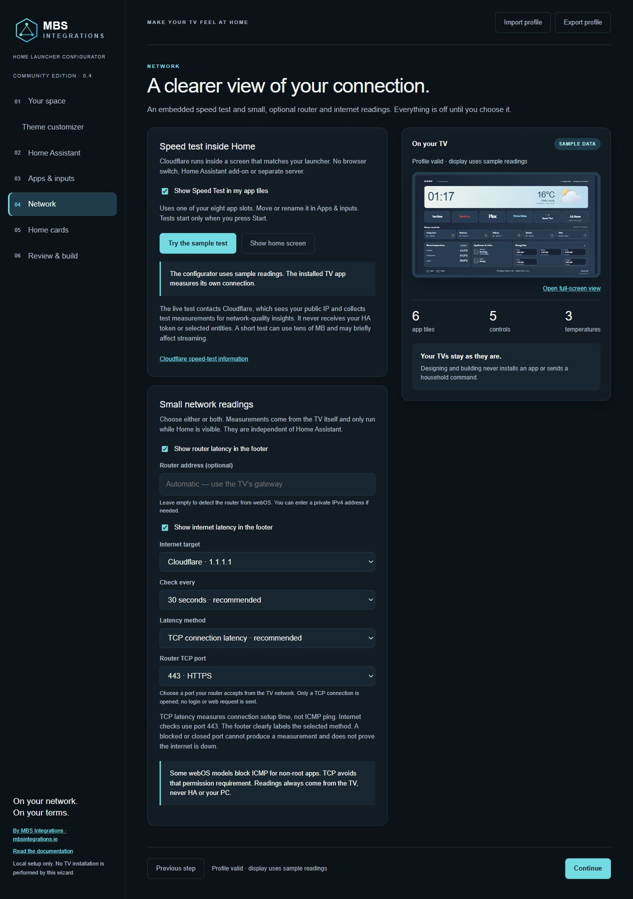

# Speed Test and network latency

In the configurator, open **Network**. Both features are optional and off by default. No separate server, HA add-on or root is required.

## Embedded speed test

Enable **Show Speed Test in my app tiles**. It uses one of the eight app slots, before LG Home. If all slots are occupied, remove a tile first. Reorder or rename it in **Apps & inputs**.

The tile opens a screen within Home, using your selected colour palette. Select **Start test** to measure download, upload, HTTP latency and jitter using Cloudflare. Back, Close, Cancel or hiding the app cancels the active test. Successful live results are saved locally with their timestamp. No test runs automatically, including at startup.

The configurator uses an explicitly labelled sample test. It makes no Cloudflare requests, pings or HA device commands. Sample results are never stored as measured results.

The pinned Cloudflare engine is bundled locally. No runtime CDN script, API key, HA add-on or external computer is needed. Cloudflare receives the public IP and test measurements; its engine sends completion results for aggregate network-quality insights. HA credentials, entities and household data are not passed to the engine. See [Cloudflare's engine documentation](https://github.com/cloudflare/speedtest) and the [bundled licences](NETWORK-LICENSES.txt).

The lightweight sequence has approximately 24.2 MB maximum planned payload, plus retries and protocol overhead, and stops after 60 seconds. Individual transfers are capped at 5 MB; no packet-loss/TURN or sustained parallel-load test is enabled. It can underestimate high-speed connections and is not equivalent to the full Cloudflare website benchmark. Running a test may briefly affect other streaming or network use.

The current engine is transpiled to ES5 and bundled with selected compatibility libraries. On browsers without native AbortController, an XHR-backed fetch implementation actually aborts requests when cancelled. Syntax compatibility does not establish support for Resource Timing, HTTPS trust or cross-origin requests on every TV. Unsupported/failed measurements are shown as unavailable, never as zero or a fabricated estimate.

## Router and internet latency

Enable either footer reading independently. Router uses the TV's active IPv4 gateway, with an optional private address override. Internet targets Cloudflare 1.1.1.1 or Google 8.8.8.8.

TCP connection latency is the default. It measures the time to establish a connection, without sending a login or web request. Internet checks use port 443; select router port 443, 80 or 53 to match a service your router accepts from the TV network. A closed or blocked port produces no usable measurement. The footer labels these readings **TCP latency**, which is different from ICMP ping and the speed test's HTTP latency.

ICMP remains an optional method for TVs that permit it. The tested Living Room B9 rejects both the system ping utility and the native LG ping API from a non-root app. No permissions are elevated and there is no silent fallback between methods.

The private, read-only JavaScript service is included only when latency is enabled. It checks only the selected targets every 15, 30 or 60 seconds (default 30), with bounded timeouts. Polling stops while Home is hidden and pauses during a speed test. An already-started check may finish within its short timeout. No Home-button helper, HA add-on or external computer is required.

No reply or Unavailable can indicate a blocked port, missing gateway, missing permissions or unreachable target. Neither proves the internet is down. Measurements come from the TV, never HA or the setup PC. IPv6-only gateway detection is not currently supported.

## Tested behaviour

The OLED65B9PLA completed the embedded Cloudflare test, cancellation, and router/internet TCP measurements. The owner confirmed the feature worked. The bundled engine supports this TV's Chromium 53 resource timing even though nextHopProtocol is absent. ICMP is blocked for non-root apps on this model. The 65NANO766QA also completed the embedded test and returned both TCP readings from the installed service. See [compatibility](VALIDATION.md) for tested models and expected platform support.
